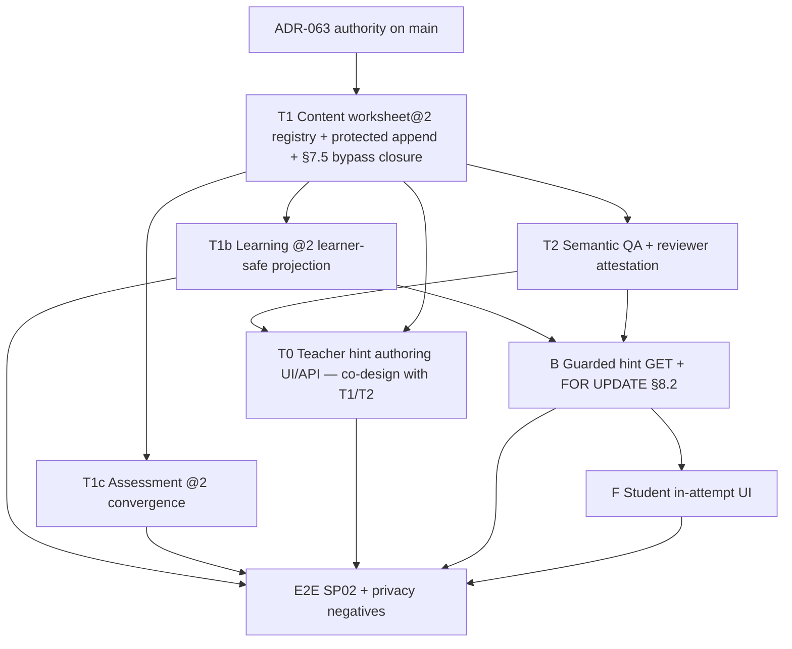

# AIEOS-PROGRAM-RB01 — Full-Scope Requirements Traceability & Programme Rebaseline

**Governance:** **FOUNDER-APPROVED QUALITY-FIRST, NO-SILENT-SCOPE-CUT REBASELINE DIRECTION** ([Issue #62](https://github.com/eduvijna-ai/eduvijna-architecture/issues/62)). **DESIGN / PLANNING ONLY.** No product code, merge, production, or UAT authorized by this correction.

**Deposit chain (Git — record exact SHAs in PR completion comment only, not self-referential commit IDs in this file):** P01 → R1 → R2 → **R3 (this revision)** on [PR #63](https://github.com/eduvijna-ai/eduvijna-architecture/pull/63).

**STOP (R3 end-state):** `RB01-P01R3 RECORD ACCURACY CORRECTION / NO SCOPE CUT / DATES UNVALIDATED / CHIEF RE-REVIEW PENDING / NO PRODUCT CODE AUTHORIZED`

---

## A — Workday identity

| Field | Value |
|-------|-------|
| Programme | AIEOS-PROGRAM-RB01 |
| Founder authorization | **2026-11-04** (policy unchanged) |
| Mode | Edit **only** this Markdown file on branch `cursor/aieos-program-rb01-traceability-7b2f` |
| Packet | **AIEOS-PROGRAM-RB01-P01R3** — narrow record-accuracy correction |
| PR base (`main`) | `ebd0f5c67550638852c12d32a60d1671b130ae85` |
| Prior reviewed deposits | P01 → R1 → R2 (exact SHAs in PR comment only) |
| R3 direct parent (expected) | R2 HEAD `9198633250e8a6f3e70f03ba7c263ce9557da694` |

---

## B — Exact-source gate (re-verified before R3 write)

Re-verification **2026-11-04** (post Chief review): `git fetch origin main` + `git ls-remote` + `gh pr view`.

| Authority | Expected | Verified |
|-----------|----------|----------|
| Architecture `main` | `ebd0f5c67550638852c12d32a60d1671b130ae85` | **MATCH** |
| Product `main` | `b4b3048fb7a6a1c50ae8619dc490743714f2e3e2` | **MATCH** |
| Backend `main` | `637583f42b7c475ef83f6f99bca7e65e665a253d` | **MATCH** |
| Frontend `main` | `569ef8be46617ab1412ddb3f5a0214c40bdb946b` | **MATCH** |
| Infrastructure `main` | `a8654e5bc680eac1fa93cf8308d7cad904f4d7b9` | **MATCH** |
| OpenAPI SHA-256 | `4042FB2725DA70A02A70EE09563B7698AE2E5DA82927614CAF1B5F7E6AA7C1D0` | **MATCH** (unchanged) |
| Alembic head | `a360s010004` | **MATCH** (unchanged) |

### B.1 — PR states (unchanged; not modified)

| PR | State | Draft | Head OID |
|----|-------|-------|----------|
| Arch **#63** (this deposit) | OPEN | YES | Base `ebd0f5c…`; tip moves with additive commits (see PR, not self-SHA in file) |
| Arch **#59** ADR-063 | MERGED | — | `097caebe2a18d3cd195aa996d05e1a910200e310` → merge `ebd0f5c…` |
| Arch **#57, #55, #53, #51** | OPEN | YES | Issue #62 historical heads |
| Product **#3** | OPEN | YES | `90511df0358dcee1236adcde73659bfb2be95e37` |

**Gate:** **PASS** — R3 write authorized.

**Architecture Actions:** `.github/workflows/.gitkeep` only — **NO CI CONFIGURED** on this repo.

---

## C — Git branch and diff scope

| Field | Value |
|-------|-------|
| Branch | `cursor/aieos-program-rb01-traceability-7b2f` |
| PR merge base | `ebd0f5c67550638852c12d32a60d1671b130ae85` (Architecture `main`) |
| Deposit ancestry | P01 → R1 → R2 → R3 additive commits |
| Diff vs `main` | **One file only:** this document |

---

## D — Evidence pins & matrix conventions

**Pins:** Backend `637583f42…` · Frontend `569ef8be…` · Product `b4b3048f…` · Infrastructure `a8654e5b…`

### D.1 — Mutually exclusive **implementation status** (Class column)

Allowed values only: **`DONE_VERIFIED`** · **`PARTIAL`** · **`NOT_STARTED`** · **`REQUIRES_PRODUCT_DECISION`** · **`SOURCE_REQUIRED`**

- **`DONE_VERIFIED`:** Pinned code + cited path and/or named test/closeout evidence at SHA (or architecture text on `main` when row is **authority-only** and explicitly labeled).
- **`PARTIAL`:** Material implementation exists but acceptance/security/UX/UAT/integration residual remains.
- **`NOT_STARTED`:** No governed implementation at pin (architecture may still be frozen).
- **`REQUIRES_PRODUCT_DECISION`:** Discovery/draft backlog — not approved execution scope until Product/Founder reconciles.
- **`SOURCE_REQUIRED`:** Agreed-in-principle but no reproducible authoritative source in GitHub — Founder reconciliation required.

**Not a Class value:** source/authority labels (`FROZEN`, `APPROVED`, `DRAFT`, `VISION`) — use **Authority** column.

### D.2 — Supplement evidence fields (CX01 / showcase rows)

Separate columns where noted: **`Baseline@pin`** · **`Verification gap`** · **`Founder UAT`**

### D.3 — Development vs production taxonomy

Rows tagged **`[DEV]`** belong to development-readiness / V1 critical path. Rows tagged **`[PROD]`** are production-runtime/infra hardening per ADR-AIEOS-029…051 — **out of V1 dev-ready critical path**; frozen architecture ≠ product feature complete.

### D.4 — Scope binding (separate from **Class** — governs commitments & denominators)

| Bind | Meaning | In **agreed feature denominator**? | In **critical-path packet math**? |
|------|---------|--------------------------------------|-----------------------------------|
| **APPROVED_AGREED** | Frozen/approved Founder scope with reproducible source | **Yes** (when `[DEV]`) | **Yes** (when not `DONE_VERIFIED`) |
| **ARCHITECTURE_AUTHORITY_ONLY** | Frozen ADR text on `main`; no product claim | No | No |
| **FUTURE_CONDITIONAL_ADR** | Requires forward ADR + Founder approval (forbidden today) | No — tracked, not promised | No |
| **VISION_TO_RATIFY** | Vision / draft — not authorized coding | No | No |
| **FORBIDDEN_CURRENT_AUTHORITY** | Contradicts frozen ADR (e.g. AIEOS roster SoR vs ADR-062 external master) | **No — not a missing feature** | No |
| **ROLLUP_NON_ADDITIVE** | Summary row only (phase/hint rollup) | No — do not double-count children | No |
| **SOURCE_RECONCILIATION** | SRC register / missing GitHub source | No until reconciled | No |
| **DISCOVERY_DRAFT** | Draft PR backlog (DR01/EX01/SP01) | No until reconciled | No |

**Evidence confidence (R3):** Rows whose **Authority** is `PA DRAFT`, `Product DRAFT`, or **roadmap family only** without atomic frozen/approved acceptance must use **SOURCE_RECONCILIATION** for **Bind** even when the programme direction is preserved under **NO_CUT**.

**Completion reporting:** **Never** cite `DONE_VERIFIED / 100` as “% of AIEOS complete.” Report **`DONE_VERIFIED` among `APPROVED_AGREED` + `[DEV]` rows only** (§L.2).

---

## E — Client-safe status (external)

**Policy (approved):** No silent scope cuts; extend dates before quality compromise.

**What is already real (development slices — not full product / not production):** TOS-DEV10 + TOS-CX01; S01–S04 development slices; cross-role data-plane E2E; AIEOS360 showcase operator tooling **I01R9–I07 baseline @ Frontend pin** ([K.3](#k3--aieos360-showcase-w01-planned-names--implemented-packages--frontend-pin)) — residuals + Founder UAT remain.

**Not claimed:** 100% original AIEOS implemented; production ERP/Admin OS; EIS; Agents/MCP platform; ADR-063 hint **code**; ratified schedule dates.

**Dates for clients:** Historical Nov20/Dec18/Jan–May 2027 baselines preserved for comparison. **No new exact calendar commitment** until Founder ratifies a Chief-reviewed bottom-up plan. Illustrative hypotheses labeled **UNVALIDATED** in Section H.

---

## F — Founder decision sheet

| Item | Status |
|------|--------|
| No-scope-cut / quality-first | **APPROVED 2026-11-04** |
| This expanded baseline + illustrative dates | **DRAFT — NOT RATIFIED** |
| ADR-063 architecture on `main` | **FROZEN / APPROVED** — implementation **NOT AUTHORIZED** |
| Rebuild CX01 launcher/reseed/mode/cue sheet | **NOT REQUIRED** — already @ Frontend pin; close **residuals** only |

---

## G — Quality gates (unchanged definitions)

Development-ready · Client showcase-ready · Founder UAT · Production-ready remain **distinct**. **`NO_CUT`:** only Founder may descope; else date moves.

---

## H — Programme rebaseline & capacity model

### H.1 — Historical baselines vs illustrative checkpoints

| Programme family | Historical baseline | Scope preserved |
|------------------|---------------------|-----------------|
| AIEOS 360 engineering checkpoint | 2026-11-20 | Internal evidence checkpoint — not forced readiness |
| AIEOS V1 dev-ready | 2026-12-18 | V1-EXPAND + reconciled matrix **[DEV]** rows |
| Experience Depth | 2027-01-29 | Role depth, a11y, Indian-school UX (**SRC-03**) |
| ERP / School Ops | 2027-02-26 | Real Admin/ERP **[DEV]** |
| EIS + Knowledge | 2027-03-26 | Curriculum/graph/multilingual |
| Agents / MCP / AI Engineering | 2027-04-23 | Governed agents/MCP |
| Ecosystem / Developer | 2027-05-21 | **SRC-02** reconciliation |
| Full original AIEOS dev complete | 2027-05-28 | All **agreed** REQ rows `DONE_VERIFIED` |

### H.2 — Illustrative checkpoint dates (**UNVALIDATED — NOT FOUNDER COMMITMENTS**)

Prior P01 dates (e.g. **2027-04-17**, **2027-12-18**) were **Saturday** checkpoints, mislabeled “Friday”, and **not** derived from counted packets at verified throughput. **Withdrawn as defensible commitments.** Retained only as **UNVALIDATED ILLUSTRATIVE** comparison anchors until Section H.3 model is Founder-ratified.

| Illustrative checkpoint | Calendar | Weekday | Label |
|-------------------------|----------|---------|-------|
| V1 dev-ready hypothesis | 2027-04-17 | Saturday | **UNVALIDATED ILLUSTRATIVE ONLY** |
| Experience Depth hypothesis | 2027-06-26 | Saturday | **UNVALIDATED ILLUSTRATIVE ONLY** |
| ERP/School Ops hypothesis | 2027-08-21 | Saturday | **UNVALIDATED ILLUSTRATIVE ONLY** |
| EIS hypothesis | 2027-10-16 | Saturday | **UNVALIDATED ILLUSTRATIVE ONLY** |
| Agents/MCP hypothesis | 2027-11-20 | Saturday | **UNVALIDATED ILLUSTRATIVE ONLY** |
| Ecosystem hypothesis | 2027-12-11 | Saturday | **UNVALIDATED ILLUSTRATIVE ONLY** |
| Full original hypothesis | 2027-12-18 | Saturday | **UNVALIDATED ILLUSTRATIVE ONLY** |

**Recommended planning bands (pending SRC-04 capacity):** V1 dev-ready **Q1–Q2 2027**; full original agreed scope **H2 2027+** — **PROPOSED / FOUNDER RATIFICATION PENDING**.

### H.3 — Effort units (**NOTIONAL SENSITIVITY EXAMPLE — cannot set dates**)

**Warning:** Counts below are **illustrative S/M/L/XL buckets**, **not** mechanically derived from every §K row (many K rows lack packet IDs; hint sub-packets in K.2 are not sized here; XL rows in K.11–K.14 were omitted in prior P01R1). **Do not use for Founder/client commitments.** **SRC-04** staffing remains a **date-ratification blocker**.

**Unit weights (example only):** S=1 · M=2 · L=4 · XL=8 · buffered = `ceil(raw × 1.25)`.

| Phase (illustrative) | Example S/M/L/XL | Raw | +25% | Maps to K? |
|----------------------|-------------------|----:|-----:|------------|
| V1 closeout | 4 / 8 / 5 / 0 | **40** | **50** | **Partial** — qualitative only |
| Experience Depth | 6 / 10 / 2 / 0 | **34** | **43** | Notional |
| ERP/School Ops [DEV] | 2 / 6 / 4 / 2 | **46** | **58** | Includes XL Admin/ERP rows |
| EIS/Knowledge | 3 / 8 / 5 / 2 | **55** | **69** | Includes XL curriculum |
| Agents/MCP | 2 / 6 / 6 / 2 | **54** | **68** | Includes XL MCP |
| Ecosystem | 1 / 4 / 4 / 1 | **33** | **42** | SRC-02 dependent |

**Throughput translation (example units → time — not calendar promises):**

- The **50** V1 **buffered** units in the table **already include** the illustrative **+25% QA/integration ceiling** on raw counts — **do not add another 25%** when translating to weeks.
- Assume **1 M-equivalent = 2 units** and **~5–7 engineering days per M-equivalent** (single serial lane). The **25–35 workweek** band **includes that illustrative buffer**; **additional** Chief review, Founder UAT scheduling, and cross-repo integration latency remain **unmodeled**.
- **V1 notional 50 units** ≈ **25 M-equivalents** ≈ **125–175 engineering days** ≈ **25–35 five-day workweeks** serial — **not** 11–15 weeks and **not** a feasible date commitment without **SRC-04**.
- **Two parallel non-colliding lanes** might halve **eligible** M-equivalents only where dependency DAG allows — **not** a guaranteed 6–8 week calendar; dependencies, staffing (**SRC-04**), and integration gates dominate.

**Critical path [DEV] (qualitative):** ADR-063 hint DAG (§J) ∥ CX01 verification/UAT residuals ∥ EX01/DR01 reconciliation → cross-role regression → later tranches. **[PROD]** off V1 dev CP.

---

## I — Non-omission / Founder reconciliation register (**5 entries — separate from matrix counts**)

| ID | Topic | Matrix linkage |
|----|-------|----------------|
| SRC-01 | Post-Dec family acceptance checklists | Maps to PHASE rows + K.8–K.14 |
| SRC-02 | External vision / conversations | RB01-ECO-* ; TO_RATIFY list |
| SRC-03 | Indian-school UX / role-depth specifics beyond Draft Product docs | `RB01-TOS-IND`, `RB01-TOS-A11Y`, `RB01-TOS-LOOP`, `RB01-STU-A11Y`, `RB01-PRI-UX`, `RB01-PAR-UX`, `RB01-EIS-ML` |
| SRC-04 | Team capacity / FTE | Section H.3 — **blocks date ratification** |
| SRC-05 | Production provider spend | **[PROD]** charter only |

**TO_RATIFY (vision):** marketplace monetization, autonomous multi-agent classrooms, inferred personalization, Principal learner drill-down, Parent evaluation scores — **new ADR + Founder approval** before counting as agreed scope.

---

## J — ADR-063 dependency DAG (Founder-frozen; not a serial fiction)

**Authority:** `RB01-HINT-ARCH` **DONE_VERIFIED** (architecture on `main` only).

**Parallelism notes:** T1b and T1c both depend on **T1** only (not on each other). **B** requires T1b + School Context + published attested hint version (T2). **T0** follows T1+T2 backend gates but may **co-design** UX/contracts earlier without claiming shippable hint vertical. **E2E** gates on all required lanes.

### PK-HINT-A — first bounded code packet (**proposal — NOT AUTHORIZED**)

| Attribute | Content |
|-----------|---------|
| **Scope** | **Backend-only:** register `education.worksheet@2`; extend guarded Content append path with O63 owner/class gates; **fail-closed** negative HTTP tests on generic append bypass (§7.5); staged review attestation hooks for T2 (no Student routes) |
| **Explicitly excludes** | Published hint-bearing content in client use; Teacher UI completion; hint GET **B**; Student **F**; migrations beyond minimal `@2` registration unless Chief charter says otherwise |
| **Proof** | Unit/integration tests: schema validation; unauthorized append denied; `@1` unchanged; audit/authorization on append command |
| **Repos** | Backend (+ OpenAPI snapshot); Product tests as chartered |
| **STOP** | Separate **Founder code authorization** required; no merge claim from planning doc |

---

## K — Requirements matrix

**Column key:** **Class** = implementation status (§D.1) · **Auth** = source authority · **Bind** = scope binding (§D.4) · full **Bind** index in **§K.0**

### K.0 — Scope binding index (all matrix Req-IDs)

| Req-ID | Bind |
|--------|------|
| RB01-TOS-DEV10 … RB01-S04 (8) | APPROVED_AGREED |
| RB01-HINT-ARCH | ARCHITECTURE_AUTHORITY_ONLY |
| RB01-HINT-T1 … RB01-HINT-E2E (8) | APPROVED_AGREED |
| RB01-CX01-I01R9 … RB01-CX01-I07 (7) | APPROVED_AGREED |
| RB01-CX01-I08 | APPROVED_AGREED (acceptance gate — docs/UAT, not greenfield code) |
| RB01-DR01, RB01-EX01, RB01-SP01 | DISCOVERY_DRAFT |
| RB01-ADR-022 … RB01-ADR-AI-044 (DEV rows) | APPROVED_AGREED (platform `[DEV]` baseline) |
| RB01-ADR-029 … RB01-ADR-051 (PROD rows) | APPROVED_AGREED (**[PROD]** — out of V1 dev CP) |
| RB01-PHASE-ED … RB01-PHASE-ECO (5) | ROLLUP_NON_ADDITIVE |
| RB01-PHASE-FULL | ROLLUP_NON_ADDITIVE |
| RB01-TOS-REVIEW, RB01-TOS-AI | APPROVED_AGREED |
| RB01-TOS-LOOP | SOURCE_RECONCILIATION (programme intent APPROVED; detailed Indian-school UX **SRC-03**) |
| RB01-TOS-PLAN | VISION_TO_RATIFY |
| RB01-TOS-A11Y | SOURCE_RECONCILIATION |
| RB01-TOS-IND | SOURCE_RECONCILIATION |
| RB01-STU-ATT | APPROVED_AGREED |
| RB01-STU-HINT | ROLLUP_NON_ADDITIVE (see K.2) |
| RB01-STU-A11Y | SOURCE_RECONCILIATION |
| RB01-STU-FB, RB01-STU-MAST | VISION_TO_RATIFY |
| RB01-PRI-AGG, RB01-PAR-AGG | APPROVED_AGREED |
| RB01-PRI-DRILL, RB01-PAR-SCORE | FUTURE_CONDITIONAL_ADR (forbidden under frozen ADR-060/061 until forward ADR) |
| RB01-PRI-UX, RB01-PAR-UX | SOURCE_RECONCILIATION (`PA DRAFT` — family UX depth, not atomic approved contract) |
| RB01-ADM-S04 | APPROVED_AGREED |
| RB01-ADM-OS, RB01-ERP-LIVE | APPROVED_AGREED (future `[DEV]` — not S04 synthetic) |
| RB01-ERP-ROSTER | **FORBIDDEN_CURRENT_AUTHORITY** (not a missing agreed feature; ADR-062 external master) |
| RB01-EIS-DET | APPROVED_AGREED |
| RB01-EIS-CUR, RB01-EIS-ALIGN | SOURCE_RECONCILIATION (roadmap/programme — detailed graph/alignment acceptance not frozen) |
| RB01-EIS-ML | SOURCE_RECONCILIATION |
| RB01-AGT-GW | APPROVED_AGREED |
| RB01-AGT-MCP, RB01-AGT-SAFE | APPROVED_AGREED (deferred programme) |
| RB01-AGT-ORCH | VISION_TO_RATIFY |
| RB01-ECO-SDK, RB01-ECO-AN | SOURCE_RECONCILIATION |
| RB01-ECO-XPLAT | VISION_TO_RATIFY |
| RB01-QA-E2E, RB01-QA-CI | APPROVED_AGREED |
| RB01-QA-OBS | SOURCE_RECONCILIATION |

**Index is a discovery register — not a certified exhaustive Founder requirement list.** Rows preserved under **NO_CUT**; binding controls what counts toward commitments and denominators.

### K.1 — Closed development slices (**do not duplicate code**)

| Req-ID | Title | Auth | Class | Ev @ pin | Acc / residual |
|--------|-------|------|-------|----------|----------------|
| RB01-TOS-DEV10 | Teacher OS dev-complete experience | ADR-AIEOS-057 FROZEN | DONE_VERIFIED | Backend `domains/teaching/`, `domains/content/`; roadmap closeout SHAs | Library/Memory/Assistant v1; TOS-DEV10-C01 E2E history |
| RB01-TOS-CX01 | Teacher OS client showcase | TOS-CX01 APPROVED | DONE_VERIFIED | Frontend ArtifactRenderer; Groq via Model Gateway; Founder Real-AI **2026-09-07** | ≠ AIEOS360 unified showcase |
| RB01-TOS-DEV04-09 | Prepare→Improve native chain | ADR-052…056 FROZEN | DONE_VERIFIED | Backend teaching domains @ pin | Class-level limits per ADRs |
| RB01-S01-CORE | Student assign/attempt/submit | ADR-058 FROZEN | DONE_VERIFIED | Backend `domains/learning/`; FE student-os | No full Student OS |
| RB01-S01-I05 | Learner eval → Teacher improve | ADR-059 FROZEN | DONE_VERIFIED | `LearnerAssessmentEvaluation`; S01-I05 E2E | No learner grades |
| RB01-S02 | Principal school intelligence slice | ADR-060 FROZEN | DONE_VERIFIED | OpenAPI `principal-os/school-intelligence`; S02 E2E | No drill-down |
| RB01-S03 | Parent intelligence slice | ADR-061 FROZEN | DONE_VERIFIED | OpenAPI parent-os; S03 E2E | EVALUATION_EXISTENCE=NO |
| RB01-S04 | S04 non-prod school context | ADR-062 FROZEN | DONE_VERIFIED | `DevelopmentCoherentSchoolContextProvider`; S04-I03 E2E | Not production ERP |

### K.2 — ADR-063 learner hints **[DEV]**

| Req-ID | Title | Auth | Class | Ev @ pin | Acc / missing |
|--------|-------|------|-------|----------|---------------|
| RB01-HINT-ARCH | ADR-063 architecture authority | ADR-063 FROZEN on `main` | DONE_VERIFIED | `decisions/ADR-AIEOS-063-*.md` @ `ebd0f5c` merge | **Authority only** — not implementation |
| RB01-HINT-T1 | Content worksheet `@2` + protected append | ADR-063 §5–§7 | NOT_STARTED | `@1` only in `worksheet_v1.py` @ Backend pin | Registry, §7.5 bypass closure |
| RB01-HINT-T2 | Semantic QA + reviewer attestation | ADR-063 §5.2–§5.3 | NOT_STARTED | Review queue exists; hint lint N/A | `human_review_pass`; HARD BLOCK rules |
| RB01-HINT-T1b | Learning `@2` learner projection | ADR-063 §6 | NOT_STARTED | Assignment GET @ pin has no hint strip path | No hints on assignment GET |
| RB01-HINT-T1c | Assessment `@2` convergence | ADR-063 + ADR-055 | NOT_STARTED | Assessment @1 paths @ pin | No hint/answer leakage |
| RB01-HINT-T0 | Teacher hint authoring UI/API | ADR-063 §7; SP01R1 DRAFT | NOT_STARTED | No hint authoring UI @ FE pin | After T1+T2 backend |
| RB01-HINT-B | Attempt-scoped hint GET | ADR-063 R1 §8.2 | NOT_STARTED | Routes absent @ OpenAPI pin | FOR UPDATE; fail-closed |
| RB01-HINT-F | Student in-attempt hint UX | ADR-063 §1 | NOT_STARTED | Student UI @ pin | Optional hints; no Parent/Principal |
| RB01-HINT-E2E | SP02 adversarial suite | SP02A | NOT_STARTED | Static validation only | HTTP negatives + happy path |

### K.3 — AIEOS360 showcase: W01 planned names → implemented packages @ Frontend pin

**Authority:** [Issue #54 EX01](https://github.com/eduvijna-ai/eduvijna-architecture/issues/54) — **I01R9–I07 implemented**; I08 = acceptance gate. Do **not** rebuild launcher/reseed/mode/cue sheet/integrated guard.

| Req-ID | W01 name | Implemented package | Auth | Class | Baseline@pin | Verification gap | Founder UAT |
|--------|----------|---------------------|------|-------|--------------|------------------|-------------|
| RB01-CX01-I01R9 | I01 launcher/reseed | `showcase:aieos360:reset/start/status/stop` scripts; `Aieos360ShowcaseLauncherPage.tsx` | CX01 APPROVED | PARTIAL | FE `569ef8be` `package.json` L28–32; `scripts/aieos360-cx01-i01r9-showcase-rehearsal/` | Operator DEV session preconnect; **EVIDENCE_GAP** on fresh CI rerun @ pin | DEFERRED |
| RB01-CX01-I02 | I02 role entry | Launcher role URLs + `showcaseCrossRoleUrls.ts` | CX01 APPROVED | PARTIAL | FE `src/features/aieos360-showcase/` | Human rehearsal without engineering panel — polish | DEFERRED |
| RB01-CX01-I03 | Student UX polish | Student shell @ pin | CX01-W01 | PARTIAL | FE student-os routes | Below TOS-CX01 visual bar | DEFERRED |
| RB01-CX01-I04 | Principal/Parent polish | S02/S03 shells | CX01-W01 | PARTIAL | FE principal/parent-os | Presentation depth | DEFERRED |
| RB01-CX01-I05 | Cross-role narrative | `ShowcaseContinuity.tsx`; `docs/AIEOS360-CX01-I07-FOUNDER-CUE-SHEET.md` | CX01 APPROVED | PARTIAL | FE docs + components | Story affordances vs cue sheet rehearsal | DEFERRED |
| RB01-CX01-I06 | Mode transparency | `showcase:aieos360:configure-mode`; `ShowcaseModeTruthPanel.tsx` | CX01 APPROVED | PARTIAL | FE `scripts/aieos360-cx01-i06-showcase-ai-mode/` | Not all roles Real-AI proven | DEFERRED |
| RB01-CX01-I07 | Integrated rehearsal | `showcase:aieos360:rehearse`; `test:e2e:aieos360-cx01-i07`; `e2e-aieos360-cx01-i07/integrated-showcase-rehearsal.product.spec.ts` | CX01 APPROVED | PARTIAL | FE docs `AIEOS360-CX01-I07-INTEGRATED-SHOWCASE-REHEARSAL.md` | Zero API mock posture proven in spec; **no CI receipt re-run @ RB01** | DEFERRED |
| RB01-CX01-I08 | Founder acceptance pack | Arch PR #51; Product PR #3 DRAFT | DRAFT | NOT_STARTED | Draft docs only | **Acceptance gate** — not missing feature code | **REQUIRED** post-dev |

### K.4 — Draft programme inputs (not execution authority)

| Req-ID | Title | Auth | Class | Notes |
|--------|-------|------|-------|-------|
| RB01-DR01 | DR01 gap backlog | PR #53 DRAFT | REQUIRES_PRODUCT_DECISION | Deadline superseded; items feed matrix |
| RB01-EX01 | EX01 V1-EXPAND freeze | PR #55 DRAFT | REQUIRES_PRODUCT_DECISION | Reconcile to K.8–K.9 before code |
| RB01-SP01 | SP01R1 discovery | PR #57 DRAFT | REQUIRES_PRODUCT_DECISION | Informed ADR-063; merge needs revalidation |

### K.5 — Shared platform **[DEV] vs [PROD]** (@ Backend/Infra pin)

| Req-ID | ADR | Track | Auth | Class | Ev / gap |
|--------|-----|-------|------|-------|----------|
| RB01-ADR-022 | AIEOS-022 | DEV | FROZEN | PARTIAL | Stack baseline met |
| RB01-ADR-023R1 | AIEOS-023R1 | DEV | FROZEN | PARTIAL | Dev identity patterns |
| RB01-ADR-024 | AIEOS-024 | DEV | FROZEN | PARTIAL | Core SoRs implemented |
| RB01-ADR-025 | AIEOS-025 | DEV | FROZEN | DONE_VERIFIED | OpenAPI pin + contract discipline |
| RB01-ADR-026 | AIEOS-026 | DEV | FROZEN | PARTIAL | Dev workflow; not prod Temporal |
| RB01-ADR-027 | AIEOS-027 | DEV | FROZEN | DONE_VERIFIED | ContentVersion + review @ pin |
| RB01-ADR-028 | AIEOS-028 | DEV | FROZEN | PARTIAL | Mutation audit partial |
| RB01-ADR-033 | AIEOS-033 | DEV | FROZEN | PARTIAL | Asset architecture present |
| RB01-ADR-034 | AIEOS-034 | DEV | FROZEN | PARTIAL | Asset authority semantics |
| RB01-ADR-035 | AIEOS-035 | DEV | FROZEN | PARTIAL | Asset mutation semantics |
| RB01-ADR-036 | AIEOS-036 | DEV | FROZEN | PARTIAL | Asset security baseline |
| RB01-ADR-046R1 | AIEOS-046R1 | DEV | FROZEN | PARTIAL | Outbox events; prod NATS not active |
| RB01-ADR-AI-044 | **ADR-044** (AI platform behind services) | DEV | APPROVED | PARTIAL | `StructuredModelGateway` Fake/Groq — **not** ADR-AIEOS-044 numeric family |
| RB01-ADR-029 | AIEOS-029 | PROD | FROZEN | NOT_STARTED | Prod env baseline — **out of V1 dev CP** |
| RB01-ADR-030 | AIEOS-030 | PROD | FROZEN | NOT_STARTED | Prod JWT |
| RB01-ADR-031 | AIEOS-031 | PROD | FROZEN | NOT_STARTED | Prod authz kernel |
| RB01-ADR-037 | AIEOS-037 | PROD | FROZEN | NOT_STARTED | Prod infra |
| RB01-ADR-038 | AIEOS-038 | PROD | FROZEN | NOT_STARTED | Cross-cloud exception |
| RB01-ADR-039 | AIEOS-039 | PROD | FROZEN | NOT_STARTED | Blobstore selection |
| RB01-ADR-040 | AIEOS-040 | PROD | FROZEN | NOT_STARTED | Blobstore topology |
| RB01-ADR-041 | AIEOS-041 | PROD | FROZEN | NOT_STARTED | Backup/recovery |
| RB01-ADR-042 | AIEOS-042 | PROD | FROZEN | NOT_STARTED | Binary delivery |
| RB01-ADR-043 | AIEOS-043 | PROD | FROZEN | NOT_STARTED | AIStor boundary |
| RB01-ADR-044P | AIEOS-044…044R2 | PROD | FROZEN | NOT_STARTED | Bootstrap/preapply |
| RB01-ADR-045 | AIEOS-045 | PROD | FROZEN | NOT_STARTED | Dispatcher discovery |
| RB01-ADR-046 | AIEOS-046 | PROD | FROZEN | NOT_STARTED | Event plane IAM |
| RB01-ADR-047 | AIEOS-047 | PROD | FROZEN | NOT_STARTED | Workflow plane IAM |
| RB01-ADR-048 | AIEOS-048…048R2 | PROD | FROZEN | NOT_STARTED | OCI runtime |
| RB01-ADR-049 | AIEOS-049 | PROD | FROZEN | NOT_STARTED | State-free deploy |
| RB01-ADR-050 | AIEOS-050 | PROD | FROZEN | NOT_STARTED | Release controller |
| RB01-ADR-051 | AIEOS-051 | PROD | FROZEN | NOT_STARTED | OCI build provenance |

*(Architecture `main` holds **51** ADR-AIEOS-022…063 files; K.5 lists all **[PROD]** 029–031, 037–051 explicitly **off** V1 dev critical path.)*

### K.6 — Post-December programme families (preserved — not deleted)

| Req-ID | Family | Auth | Class | Notes |
|--------|--------|------|-------|-------|
| RB01-PHASE-ED | Experience Depth | Roadmap APPROVED | NOT_STARTED | See K.9–K.10 |
| RB01-PHASE-ERP | ERP/School Ops | Roadmap APPROVED | NOT_STARTED | See K.11 |
| RB01-PHASE-EIS | EIS + Knowledge | Roadmap APPROVED | NOT_STARTED | See K.12 |
| RB01-PHASE-AGENT | Agents/MCP | Roadmap + ADR-044 DEFER | NOT_STARTED | See K.13 |
| RB01-PHASE-ECO | Ecosystem | Roadmap + **SRC-02** | SOURCE_REQUIRED | See K.14 |
| RB01-PHASE-FULL | Full original dev complete (rollup) | Roadmap APPROVED | NOT_STARTED | Non-additive summary of child REQ rows |

### K.8 — Teacher experience depth **[DEV]** (atomic)

| Req-ID | Title | Auth | Class | Ev | Missing / Acc | Sz | Phase |
|--------|-------|------|-------|-----|---------------|-----|-------|
| RB01-TOS-LOOP | Daily loop Intent→Improve completeness | PA TLM APPROVED | PARTIAL | DEV10 closeout | Indian-school contextual missions — **SRC-03** | M | ED |
| RB01-TOS-REVIEW | Educational review/publish immutability | ADR-027 FROZEN | DONE_VERIFIED | Content @ pin | — | — | — |
| RB01-TOS-AI | Contextual AI Assistant v1 | ADR-057 FROZEN | DONE_VERIFIED | DEV10-I04 | Planner agent out | — | — |
| RB01-TOS-PLAN | Planner Agent orchestration | ADR-044 DEFER | NOT_STARTED | — | New ADR required | L | AGENT |
| RB01-TOS-A11Y | Teacher a11y WCAG target | Product DRAFT | NOT_STARTED | **EVIDENCE_GAP** | SRC-03 thresholds | M | ED |
| RB01-TOS-IND | Indian school calendar/period UX | Product DRAFT | SOURCE_REQUIRED | — | SRC-03 | M | ED |

### K.9 — Student depth & hints **[DEV]**

| Req-ID | Title | Auth | Class | Ev | Missing / Acc | Sz | Phase |
|--------|-------|------|-------|-----|---------------|-----|-------|
| RB01-STU-ATT | Attempt/submit core | ADR-058 | DONE_VERIFIED | S01 @ pin | — | — | — |
| RB01-STU-HINT | Learner hints rollup (detail in K.2) | ADR-063 | NOT_STARTED | K.2 | **Roll-up only** — do not double-count | L | V1 |
| RB01-STU-A11Y | Student a11y | Product DRAFT | NOT_STARTED | — | Keyboard/screen reader | M | ED |
| RB01-STU-FB | Governed learner feedback | VISION | NOT_STARTED | — | **TO_RATIFY** — not ADR-059 | L | ED |
| RB01-STU-MAST | Mastery/personalization | VISION | NOT_STARTED | — | **TO_RATIFY** | L | EIS |

### K.10 — Principal / Parent depth **[DEV]**

| Req-ID | Title | Auth | Class | Ev | Missing / Acc | Sz | Phase |
|--------|-------|------|-------|-----|---------------|-----|-------|
| RB01-PRI-AGG | Privacy-safe aggregates | ADR-060 | DONE_VERIFIED | S02 @ pin | — | — | — |
| RB01-PRI-DRILL | Principal learner drill-down | ADR-060 forbid | NOT_STARTED | — | **FUTURE_CONDITIONAL_ADR** only | L | — |
| RB01-PRI-UX | Principal OS product depth | PA DRAFT | PARTIAL | FE shell | Role UX parity | M | ED |
| RB01-PAR-AGG | Parent lifecycle vocabulary | ADR-061 | DONE_VERIFIED | S03 @ pin | — | — | — |
| RB01-PAR-SCORE | Parent evaluation/scores disclosure | ADR-061 forbid | NOT_STARTED | — | **FUTURE_CONDITIONAL_ADR** only | L | — |
| RB01-PAR-UX | Parent OS product depth | PA DRAFT | PARTIAL | FE shell | Consent/access UX | M | ED |

### K.11 — Real Admin / ERP **[DEV]** (beyond S04)

| Req-ID | Title | Auth | Class | Ev | Missing / Acc | Sz | Phase |
|--------|-------|------|-------|-----|---------------|-----|-------|
| RB01-ADM-S04 | Four-port non-prod context | ADR-062 | DONE_VERIFIED | S04 @ pin | — | — | — |
| RB01-ADM-OS | Admin OS product | Roadmap DEFER | NOT_STARTED | — | No admin principal @ pin | XL | ERP |
| RB01-ERP-LIVE | Production ERP/SIS current-authority adapter | ADR-062 defer | NOT_STARTED | — | External master; real integration | XL | ERP |
| RB01-ERP-ROSTER | ~~AIEOS roster/enrollment SoR~~ **scope trap — not agreed work** | ADR-062 external master | NOT_STARTED | — | **FORBIDDEN:** do not build competing SoR; track **ERP-LIVE** instead | — | — |

### K.12 — Educational Intelligence & Knowledge

| Req-ID | Title | Auth | Class | Ev | Missing / Acc | Sz | Phase |
|--------|-------|------|-------|-----|---------------|-----|-------|
| RB01-EIS-DET | DEV04/DEV10 deterministic quality | ADR-052/057 | DONE_VERIFIED | Bounded orchestration | Not full EIS | — | — |
| RB01-EIS-CUR | Curriculum/competency graph | Roadmap APPROVED | NOT_STARTED | Product vision DRAFT | Native graph SoR | XL | EIS |
| RB01-EIS-ML | Multilingual Indian relevance | **SRC-03** | SOURCE_REQUIRED | — | Founder/Product source | L | EIS |
| RB01-EIS-ALIGN | Content alignment engine | Roadmap APPROVED | NOT_STARTED | — | Separate programme | XL | EIS |

### K.13 — Agents / MCP / AI Engineering

| Req-ID | Title | Auth | Class | Ev | Missing / Acc | Sz | Phase |
|--------|-------|------|-------|-----|---------------|-----|-------|
| RB01-AGT-GW | Model Gateway providers | ADR-044 APPROVED | PARTIAL | Fake/Groq dev | Prod routing **[PROD]** | M | DEV |
| RB01-AGT-MCP | Governed MCP tool surface | ADR-044 DEFER | NOT_STARTED | — | MCP-READY posture only | XL | AGENT |
| RB01-AGT-ORCH | Multi-agent orchestration | VISION | NOT_STARTED | — | **TO_RATIFY** | XL | AGENT |
| RB01-AGT-SAFE | Eval/safety/provenance pipeline | Roadmap APPROVED | NOT_STARTED | — | Platform programme | L | AGENT |

### K.14 — Ecosystem / Founder / Developer

| Req-ID | Title | Auth | Class | Ev | Missing | Sz | Phase |
|--------|-------|------|-------|-----|---------|-----|-------|
| RB01-ECO-SDK | Platform SDK / integrations | **SRC-02** | SOURCE_REQUIRED | Product vision DRAFT | Authoritative scope | XL | ECO |
| RB01-ECO-AN | Founder analytics/management | **SRC-02** | SOURCE_REQUIRED | — | Reconciliation | L | ECO |
| RB01-ECO-XPLAT | Cross-platform clients | VISION | NOT_STARTED | — | **TO_RATIFY** | XL | ECO |

### K.15 — Cross-cutting quality **[DEV]**

| Req-ID | Title | Auth | Class | Ev | Missing / Acc | Sz | Phase |
|--------|-------|------|-------|-----|---------------|-----|-------|
| RB01-QA-E2E | Cross-role regression harness | CX01 APPROVED | PARTIAL | I07 spec @ FE pin | Continuous CI @ pin **EVIDENCE_GAP** | M | V1 |
| RB01-QA-OBS | Observability product SLOs | Product DRAFT | NOT_STARTED | — | Dashboards/alerts | M | ED |
| RB01-QA-CI | Repo CI discipline | EBP-000 | PARTIAL | Backend/FE CI exist | Arch repo none | S | ED |

### K.7 — Explicit exclusions (Founder descope only)

UI-only auth · answer-key/hint leaks · fake ERP · Parent scores · Principal drill-down without ADR · inferred personalization — **unchanged forbidden/deferred**.

---

## L — Traceability summary counts

### L.1 — Implementation **Class** (100 matrix rows)

**Rule:** Count every `| RB01-` data row in **§K.1–K.6 and K.8–K.15**.

| Implementation class | Count |
|----------------------|------:|
| DONE_VERIFIED | 18 |
| PARTIAL | 24 |
| NOT_STARTED | 50 |
| REQUIRES_PRODUCT_DECISION | 3 |
| SOURCE_REQUIRED | 5 |
| **Total matrix REQ rows** | **100** |

| Register | Count |
|----------|------:|
| **SRC-01…SRC-05** (§I) | **5** (separate from matrix) |

### L.2 — Scope **Bind** (same 100 rows — not additive with Class)

| Bind | Count |
|------|------:|
| APPROVED_AGREED | 69 |
| ARCHITECTURE_AUTHORITY_ONLY | 1 |
| FUTURE_CONDITIONAL_ADR | 2 |
| VISION_TO_RATIFY | 5 |
| FORBIDDEN_CURRENT_AUTHORITY | 1 |
| ROLLUP_NON_ADDITIVE | 7 |
| SOURCE_RECONCILIATION | 12 |
| DISCOVERY_DRAFT | 3 |
| **Total** | **100** |

**APPROVED_AGREED [DEV] progress accounting (R3-Q1):** **18** `[PROD]` rows in K.5 are **APPROVED_AGREED** but **off V1 dev CP**. **69 − 18 = 51** `APPROVED_AGREED` **[DEV]** rows after R3 binding corrections (**56** at R2 before five rows moved to **SOURCE_RECONCILIATION**). Intersection with **`DONE_VERIFIED` Class** = **17** (the 18th Class **`DONE_VERIFIED`** is `RB01-HINT-ARCH` = **`ARCHITECTURE_AUTHORITY_ONLY`**). **Forbidden:** treating **17/51**, **17/56**, or **18/100** as unique-feature completion percentages.

**ADR-063 product code @ pin:** **NOT STARTED** (hint routes absent @ OpenAPI pin).

**CI:** Architecture repo **NO CI CONFIGURED**. Backend/Frontend CI **not re-run** in RB01R2.

---

## M — QA criteria for Chief re-review

1. Re-verify §B gate on new HEAD.
2. Re-count §L from `RB01-` rows (must match table).
3. Challenge H.3 packet units against matrix **NOT_STARTED/PARTIAL** [DEV] rows.
4. Confirm no CX01 rebuild scope in implementation packets.
5. Founder ratifies **bands** before any exact date becomes client commitment.

---

## N — Related documents (not modified)

[AIEOS-ROADMAP.md](AIEOS-ROADMAP.md) · [AIEOS-CURRENT-STATE.md](AIEOS-CURRENT-STATE.md) · [AIEOS360-CX01-W01-CLIENT-SHOWCASE-GAP-BASELINE.md](AIEOS360-CX01-W01-CLIENT-SHOWCASE-GAP-BASELINE.md) · [ADR-AIEOS-063](../decisions/ADR-AIEOS-063-aieos-learner-safe-instructional-hints-authority.md)

---

**End RB01-P01R3 — await Chief exact-head re-review; no date ratified; no merge; no code authorized.**
