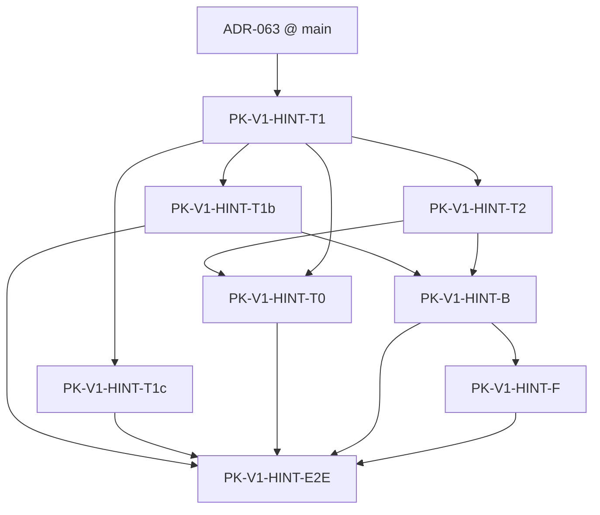
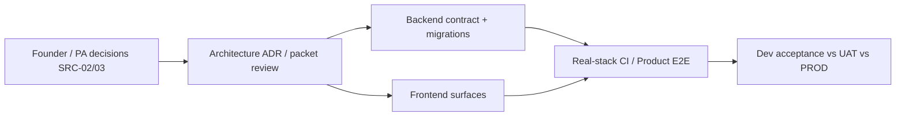

# AIEOS-PROGRAM-RB03 — Bottom-Up Delivery Packets & Capacity-Gated Rebaseline

**Governance:** **FOUNDER-APPROVED QUALITY-FIRST, NO-SILENT-SCOPE-CUT** ([Issue #66](https://github.com/eduvijna-ai/eduvijna-architecture/issues/66)). **DESIGN / PLANNING / PACKETIZATION ONLY.** No product code, merge of this or other PRs, production spend, UAT execution, exact-date ratification, or Founder atomic-scope promotion authorized by this deposit.

**Upstream (merged @ Architecture `main` `a4edadc…`):** [RB01](AIEOS-PROGRAM-RB01-FULL-SCOPE-REQUIREMENTS-TRACEABILITY-AND-REBASELINE.md) · [RB02](AIEOS-PROGRAM-RB02-REQUIREMENTS-RECONCILIATION-AND-CAPACITY-PREFLIGHT.md) (PR #65 reviewed head `8793ab81f987fd8d4adc9fa19669479085c1a667`).

**STOP (RB03 end-state):** `RB03 BOTTOM-UP PLAN DEPOSITED / FULL AGREED SCOPE PRESERVED / CAPACITY & FOUNDER RATIFICATION PENDING / NO DATES RATIFIED / NO PRODUCT CODE / NO PR MERGE / CHIEF EXACT-HEAD REVIEW PENDING`

---

## A — Workday identity

| Field | Value |
|-------|-------|
| Programme | AIEOS-PROGRAM-RB03 |
| Founder authorization | **2026-11-09** — "RB03 Authorized" |
| Mode | Read-only on five pinned `main` trees + linked Product/ADR/draft PRs; **write only this file** |
| Packet | **AIEOS-PROGRAM-RB03-P01** |
| Architecture parent (`main`) | `a4edadc979248d7abedc4d7c679b348033c57eb5` (RB02 PR #65 merge) |
| Branch | `cursor/aieos-program-rb03-bottom-up-delivery-rebaseline-437e` |
| Issue | [#66](https://github.com/eduvijna-ai/eduvijna-architecture/issues/66) |

---

## B — Exact-source gate (re-verified before P01 write)

Re-verification **2026-11-09**: `git fetch origin main`, `gh pr view 65`, `gh api` commit SHAs, OpenAPI SHA-256 check.

| Authority | Expected | Verified |
|-----------|----------|----------|
| Architecture `main` | `a4edadc979248d7abedc4d7c679b348033c57eb5` | **MATCH** |
| Product `main` | `b4b3048fb7a6a1c50ae8619dc490743714f2e3e2` | **MATCH** |
| Backend `main` | `637583f42b7c475ef83f6f99bca7e65e665a253d` | **MATCH** |
| Frontend `main` | `569ef8be46617ab1412ddb3f5a0214c40bdb946b` | **MATCH** |
| Infrastructure `main` | `a8654e5bc680eac1fa93cf8308d7cad904f4d7b9` | **MATCH** |
| OpenAPI SHA-256 (`contracts/openapi/aieos-v1.json`) | `4042FB2725DA70A02A70EE09563B7698AE2E5DA82927614CAF1B5F7E6AA7C1D0` | **MATCH** |
| Alembic head | `a360s010004` | **MATCH** (per RB02 / ADR pin tables @ Backend `637583f42…`) |

### B.1 — PR states (unchanged; not modified)

| PR | State | Draft | Head OID | RB03 role |
|----|-------|-------|----------|-----------|
| Arch **#65** RB02 | **MERGED** | — | Review `8793ab81…` → merge `a4edadc…` | Upstream reconciliation |
| Arch **#63** RB01 | **MERGED** | — | Into `1fbbc356…` chain | Register |
| Arch **#59** ADR-063 | **MERGED** | — | ADR frozen on `main` | Hint authority |
| Arch **#57** SP01 | OPEN | YES | `5182f99d028f32bcd55570c5d44f5c1f64ad5277` | Decision dependency — not auto-merge |
| Arch **#55** EX01 | OPEN | YES | `8b1d07692e1698cf2be9d338f6d45a1707719146` | Decision dependency |
| Arch **#53** DR01 | OPEN | YES | `70986a013ce776257f739eff6ab89727d6715df9` | Decision dependency |
| Arch **#51** CX01 pack | OPEN | YES | `87725067d3aa9f39dff05e634f71b05d8da85cd0` | Acceptance dependency (I08) |
| Product **#3** | OPEN | YES | `90511df0358dcee1236adcde73659bfb2be95e37` | Acceptance dependency |
| Arch **#66** RB03 (this deposit) | — | — | Owner-opens draft after push | Planning only |

**Gate:** **PASS** — RB03 P01 write authorized.

**Architecture Actions:** `.github/workflows/.gitkeep` only — **NO CI CONFIGURED**. Backend/Frontend CI **not re-run** in RB03.

---

## C — Git branch and diff scope

| Field | Value |
|-------|-------|
| Branch | `cursor/aieos-program-rb03-bottom-up-delivery-rebaseline-437e` |
| Sole parent | `a4edadc979248d7abedc4d7c679b348033c57eb5` |
| Diff vs `main` | **One file only:** this document |
| Other repos / files / draft PRs / ADRs | **Untouched** |

---

## D — Evidence ledger (frozen read-only pins)

| Artifact | Path / reference @ pin |
|----------|-------------------------|
| RB01 register | `AIEOS/AIEOS-PROGRAM-RB01-FULL-SCOPE-REQUIREMENTS-TRACEABILITY-AND-REBASELINE.md` @ `a4edadc…` |
| RB02 supplement | `AIEOS/AIEOS-PROGRAM-RB02-REQUIREMENTS-RECONCILIATION-AND-CAPACITY-PREFLIGHT.md` @ `a4edadc…` |
| ADR-063 | `decisions/ADR-AIEOS-063-aieos-learner-safe-instructional-hints-authority.md` |
| ADR-057…062 | `decisions/` @ Architecture `main` |
| OpenAPI contract | Backend `contracts/openapi/aieos-v1.json` @ `637583f42…` |
| Showcase baseline | FE `569ef8be…` — `src/features/aieos360-showcase/`, `scripts/aieos360-cx01-*` |
| Issue #66 workday | Controlling RB03 scope and STOP line |

**Global privacy / authority negatives (unchanged):** No answer-key or hint leakage (ADR-063); no Principal learner drill-down or Parent evaluation scores without forward ADR (ADR-060/061); **no AIEOS roster/enrollment SoR** (ADR-062 external master); tenant isolation and ContentVersion immutability (ADR-027).

**Do not rebuild closed slices:** TOS-DEV10/CX01; S01–S04; CX01 I01R9–I07 baseline @ Frontend pin — verification, polish, UAT residuals only (RB01 K.1 / RB02 D).

---

## E — Normalized atomic deliverables & overlap accounting (RB01 §K)

### E.1 — Why 100 matrix rows ≠ 100 independent features

| Layer | Count | Rule |
|-------|------:|------|
| RB01 matrix REQ rows (§K.1–K.6, K.8–K.15) | **100** | Discovery register |
| **ROLLUP_NON_ADDITIVE** | **7** | e.g. `RB01-STU-HINT`, `RB01-PHASE-*` — **exclude** from unique work denominator |
| **ARCHITECTURE_AUTHORITY_ONLY** | **1** | `RB01-HINT-ARCH` — frozen text, not implementation |
| **FORBIDDEN_CURRENT_AUTHORITY** | **1** | `RB01-ERP-ROSTER` — **not** missing agreed work |
| **APPROVED_AGREED** bind | **69** | Commitment-eligible when ratified |
| **APPROVED_AGREED [PROD]** (K.5) | **18** | Off V1 dev critical path |
| **APPROVED_AGREED [DEV]** | **51** | V1 / dev CP denominator (RB01 §L.2) |
| **`DONE_VERIFIED` ∩ [DEV] APPROVED_AGREED** | **17** | Closed dev evidence @ pin |
| **Uncompleted [DEV] APPROVED_AGREED** | **34** | Primary packetization target (51 − 17) |
| **`SOURCE_RECONCILIATION`** | **12** | Programme intent preserved — **DECISION_BLOCKED** packets, not approved execution |
| **`DISCOVERY_DRAFT`** | **3** | DR01/EX01/SP01 — reconcile before counting as execution |
| **`VISION_TO_RATIFY`** | **5** | Conditional / not authorized coding |
| **`FUTURE_CONDITIONAL_ADR`** | **2** | PRI-DRILL, PAR-SCORE — forbidden today |

**Forbidden completion math:** Never cite `17/51`, `17/100`, or hint rollup + atomic hint rows as a single completion percentage.

### E.2 — Atomic status lens (planning — not Class replacement)

| Status | Meaning in RB03 packets |
|--------|---------------------------|
| **DONE_VERIFIED** | Closed @ pin — packet = verification-only or **no new code** (residual CI/UAT) |
| **IN_PROGRESS** | **PARTIAL** Class — bounded residual packet |
| **MISSING** | **NOT_STARTED** APPROVED_AGREED [DEV] |
| **DECISION_BLOCKED** | SOURCE_RECONCILIATION / SRC / TO_RATIFY — start gate = Founder/Product Architecture |

### E.3 — Segment: V1 dev critical path vs full-original [DEV]

| Segment | Definition | Packet ID prefix |
|---------|------------|------------------|
| **V1-CP** | Hint vertical (K.2), CX01 verification (K.3), QA-E2E/CI (K.15), platform DEV ADR closeout residuals blocking V1 | `PK-V1-*` |
| **FULL-DEV** | Post-V1 programme rows still **APPROVED_AGREED [DEV]** (ADM-OS, ERP-LIVE, AGT-MCP, etc.) | `PK-FD-*` |
| **CONDITIONAL** | Rows pending SRC / ratification | `PK-CND-*` |

### E.4 — Uncompleted **APPROVED_AGREED [DEV]** → packet map (34 rows)

| RB01 Req-ID | Class | RB03 packet(s) |
|-------------|-------|----------------|
| HINT-T1 … HINT-E2E (7 impl) | NOT_STARTED | PK-V1-HINT-* (§H.1) |
| CX01-I01R9 … I08 (8) | PARTIAL / NS | PK-V1-CX-* (§H.2) |
| QA-E2E, QA-CI | PARTIAL | PK-V1-QA-* (§H.3) |
| ADR-022, 023R1, 024, 026, 028 | PARTIAL | PK-V1-PLT-022-028 |
| ADR-033, 034, 035, 036 | PARTIAL | PK-V1-PLT-033-036 |
| ADR-046R1, ADR-AI-044 | PARTIAL | PK-V1-PLT-046R1, AGT-GW rolled to PK-V1-AGT-GW |
| AGT-GW | PARTIAL | PK-V1-AGT-GW |
| TOS-LOOP | PARTIAL | PK-V1-TOS-LOOP-RES (+ PK-CND-TOS-LOOP for Indian depth) |
| ADM-OS, ERP-LIVE | NOT_STARTED | PK-FD-* (§H.5) |
| AGT-MCP, AGT-SAFE | NOT_STARTED | PK-FD-AGT-* |
| EIS-CUR, EIS-ALIGN | NOT_STARTED | PK-FD-EIS-* (blocked by §F) |

*Rows with **Bind ≠ APPROVED_AGREED** (12× `SOURCE_RECONCILIATION`, `VISION_TO_RATIFY`, `DISCOVERY_DRAFT`, rollups, forbidden) use §F / §H.6 — not counted in the 34 but **preserved under NO_CUT**.*

---

## F — Twelve `SOURCE_RECONCILIATION` carry-forward (RB02 §I — 0/12 promoted)

Each row retains **FDP=Y**. RB03 maps each to **`PK-CND-*`** with start gate **Founder/Product ratification** — **not** approved engineering execution.

| RB01 ID | NMAS | FDP category | RB03 packet | Start gate |
|---------|:----:|--------------|-------------|------------|
| TOS-LOOP | N | Product ratify | PK-CND-TOS-LOOP | SRC-03 + PA-LOOP-001 sign-off |
| TOS-A11Y | N | Product ratify | PK-CND-TOS-A11Y | ENG-A11Y-001 approved + FE CI |
| TOS-IND | **Y** | Product + forward ADR | PK-CND-TOS-IND | SRC-03 + institutional read-model ADR |
| STU-A11Y | **Y** | Product ratify | PK-CND-STU-A11Y | Student ENG-A11Y addendum |
| PRI-UX | N | Product ratify | PK-CND-PRI-UX | SRC-03 role-depth brief |
| PAR-UX | N | Product ratify | PK-CND-PAR-UX | SRC-03 multilingual/comms |
| EIS-CUR | **Y** | Forward ADR | PK-CND-EIS-CUR | Graph SoR ADR |
| EIS-ALIGN | **Y** | Forward ADR | PK-CND-EIS-ALIGN | After EIS-CUR ADR |
| EIS-ML | N | Product ratify | PK-CND-EIS-ML | SRC-03 medium list |
| ECO-SDK | **Y** | SRC-02 + Product | PK-CND-ECO-SDK | SRC-02 evidence |
| ECO-AN | **Y** | SRC-02 + Product | PK-CND-ECO-AN | SRC-02 Founder brief |
| QA-OBS | N | Product + [PROD] | PK-CND-QA-OBS-DEV / PK-PROD-OBS | Split DEV telemetry vs SRC-05 |

**Accounting (unchanged from RB02 §I.0):** ID_ADDRESSED **12/12** · RSF **9/12** · NMAS **6/12** · FDP **12/12** · Promoted without ratification **0**.

Full per-row acceptance, size, and evidence: **cite RB02 §I.1** — not duplicated here to avoid drift.

---

## G — SRC-01…SRC-05 dispositions (RB02 §J)

| SRC | Topic | RB03 disposition | Blocks |
|-----|-------|------------------|--------|
| **SRC-01** | Post-Dec family checklists | Atomic candidates listed RB02 J.1 — **NEEDS_FOUNDER_RATIFICATION** before sizing post-V1 tranches | PK-FD-* calendar binding |
| **SRC-02** | External conversations | **STILL_SOURCE_REQUIRED** for ECO-* @ pin — evidence checklist RB02 J.2 | PK-CND-ECO-* |
| **SRC-03** | Indian-school fidelity | Draft corpus **SOURCE_FOUND** — thresholds **NEEDS_FOUNDER_RATIFICATION** (RB02 J.3) | PK-CND-TOS-*, STU-A11Y, PRI/PAR-UX, EIS-ML |
| **SRC-04** | Capacity / FTE | **UNKNOWN** — Founder checklist §M.1 | **All date ratification** |
| **SRC-05** | Production spend | **[PROD] charter only** — ADR-029…051 (RB01 K.5) | PK-PROD-* execution |

---

## H — Delivery packet register

### H.0 — Register conventions (RB03-06)

Each **approved** uncompleted **[DEV]** row maps to ≥1 packet. Fields below use compact tables; **Human owner = UNKNOWN** unless evidenced in repos (RB02 H.1).

| Column | Meaning |
|--------|---------|
| **PK-ID** | Stable packet identifier |
| **Req-IDs** | RB01 matrix IDs |
| **Bind / Class** | RB01 §K |
| **Owner DOMAIN** | Architecture / Backend / Frontend / Product / Cross |
| **Repos** | Target implementation repos |
| **Start gate** | Must pass before coding authorization |
| **Size** | S/M/L/XL + confidence (`RB01-aligned` / `hypothesis` / `UNKNOWN`) |
| **Auth** | `NOT AUTHORIZED FOR CODE` unless future Founder code authorization |

### H.1 — V1 critical path: ADR-063 hint vertical (atomic — no rollup double-count)

| PK-ID | Req-IDs | Class | Owner | Repos | Dependencies | Start gate | In scope | Out of scope | User outcome | E2E accept (+) | Adversarial (-) | Proof | Size |
|-------|---------|-------|-------|-------|--------------|------------|----------|--------------|--------------|----------------|-------------------|-------|------|
| PK-V1-HINT-T1 | HINT-T1 | NOT_STARTED | Backend | be | ADR-063 §5–7 | Founder code auth post-PK-HINT-A | `education.worksheet@2` registry; guarded append; §7.5 bypass closure | Student routes; publish to clients | Content owners register hint-bearing worksheet schema | Append with owner gates succeeds; `@1` unchanged | Generic append bypass; cross-tenant append | BE unit/integration; OpenAPI diff | M · RB01-aligned |
| PK-V1-HINT-T2 | HINT-T2 | NOT_STARTED | Backend | be | T1 | T1 merged | Semantic QA + `human_review_pass`; HARD BLOCK lint | Auto-publish | Reviewers attest hint-safe content | Review queue rejects leakage patterns | Answer text in hint field | BE tests + review fixtures | M · RB01-aligned |
| PK-V1-HINT-T1b | HINT-T1b | NOT_STARTED | Backend | be | T1 | T1 merged | Learning `@2` learner-safe projection on assignment GET | Raw hint on GET | Learners see assignment without answer leakage | Assignment GET strips forbidden fields | Hint body on assignment GET | BE contract tests | M · RB01-aligned |
| PK-V1-HINT-T1c | HINT-T1c | NOT_STARTED | Backend | be | T1 | T1 merged | Assessment `@2` convergence w/ ADR-055 | Score leakage | Assessment attempt flow unchanged safety | Attempt submit works | Hint/answer in assessment payload | BE tests | M · RB01-aligned |
| PK-V1-HINT-T0 | HINT-T0 | NOT_STARTED | Cross | be, fe | T1, T2 | T1+T2 BE gates | Teacher hint authoring API/UI contracts | In-attempt student use | Teachers author hints under governance | Save draft → review → publish path | Teacher sees learner attempt answers | FE component tests; BE API | L · hypothesis |
| PK-V1-HINT-B | HINT-B | NOT_STARTED | Backend | be | T1b, T2, S04 context | Published attested version | Attempt-scoped hint GET §8.2 FOR UPDATE | Unscoped listing | Learner requests hint within attempt policy | 404/403 when attempt closed | Cross-learner hint fetch | BE HTTP + PG integration | M · RB01-aligned |
| PK-V1-HINT-F | HINT-F | NOT_STARTED | Frontend | fe | B | B + contract pin | In-attempt hint UX | Parent/Principal surfaces | Learner optional hint in attempt UI | Happy path hint display | Hint in AT/exposed DOM to extensions | FE tests; SP02 scenarios | M · RB01-aligned |
| PK-V1-HINT-E2E | HINT-E2E | NOT_STARTED | Cross | be, fe, product | T0, B, F | All hint lanes | SP02 adversarial suite @ real stack | Mock-only proof | End-to-end hint vertical demonstrable | SP02A happy path | RB01 K.7 exclusion list | Product E2E spec; CI receipt | L · RB01-aligned |

**PK-HINT-A (recommendation only — NOT AUTHORIZED):** First coding candidate = **PK-V1-HINT-T1** scope only (Backend-only), per RB02 §H.3 — excludes B/F/T0/Student GET.

### H.2 — V1 critical path: AIEOS360 CX01 verification (no launcher rebuild)

| PK-ID | Req-IDs | Class | Owner | Repos | Dependencies | Start gate | In scope | Out of scope | User outcome | E2E accept (+) | Adversarial (-) | Proof | Size |
|-------|---------|-------|-------|-------|--------------|------------|----------|--------------|--------------|----------------|-------------------|-------|------|
| PK-V1-CX-I01R9 | CX01-I01R9 | PARTIAL | Frontend | fe | — | None for polish | Fresh rehearsal + optional CI script rerun | Rebuild launcher architecture | Operator can reset/start showcase | Scripts exit 0 @ pin | Hardcoded prod URLs | FE script logs; manual checklist | S · RB01-aligned |
| PK-V1-CX-I02 | CX01-I02 | PARTIAL | Frontend | fe | I01R9 | — | Role entry URL polish | New auth model | Each role reaches shell from launcher | URLs resolve in dev | Cross-tenant token in URL | FE e2e smoke | S · hypothesis |
| PK-V1-CX-I03 | CX01-I03 | PARTIAL | Frontend | fe | — | SRC-03 optional for copy | Student visual polish | New learning features | Showcase student path presentable | Rehearsal without engineering panel | PII in demo labels | Manual showcase | M · hypothesis |
| PK-V1-CX-I04 | CX01-I04 | PARTIAL | Frontend | fe | — | SRC-03 optional | Principal/Parent polish | Drill-down / scores | Role shells presentable | ADR-060/061 aggregates only | Forbidden drill-down affordances | Manual + unit tests | M · hypothesis |
| PK-V1-CX-I05 | CX01-I05 | PARTIAL | Frontend | fe | I02–I04 | — | Cross-role narrative continuity | Full product storyline | Continuity component matches cue sheet | Rehearsal doc steps pass | Broken handoff between roles | FE docs + rehearsal | M · RB01-aligned |
| PK-V1-CX-I06 | CX01-I06 | PARTIAL | Frontend | fe | — | — | Mode transparency panel truthfulness | Live prod AI keys | Operator sees real vs fake AI mode | configure-mode script + UI | Mislabeled Real-AI | Script + UI test | S · RB01-aligned |
| PK-V1-CX-I07 | CX01-I07 | PARTIAL | Cross | fe, be | I05, I06 | Integration env | Integrated rehearsal + product spec rerun | API mock regression | One-command integrated rehearsal | `test:e2e:aieos360-cx01-i07` green @ fresh run | Mocked backend in integrated path | CI receipt (BE+FE) | M · RB01-aligned |
| PK-V1-CX-I08 | CX01-I08 | NOT_STARTED | Cross | arch, product | #51, Product #3 | Draft PR review | Founder acceptance **pack** (docs/checklists) | New feature code | UAT-ready evidence bundle | Chief+Founder sign checklist | Treating doc pack as feature complete | Arch #51 + Product #3 merge **Founder auth** | S · RB01-aligned |

### H.3 — V1 cross-cutting quality & platform [DEV] residuals

| PK-ID | Req-IDs | Class | Owner | Repos | Start gate | Summary | Size |
|-------|---------|-------|-------|-------|------------|---------|------|
| PK-V1-QA-E2E | QA-E2E | PARTIAL | Cross | fe, be | I07 stable | Continuous cross-role regression harness @ pin; close **EVIDENCE_GAP** on fresh CI | M |
| PK-V1-QA-CI | QA-CI | PARTIAL | Platform | all | — | Architecture repo still no CI; ensure BE/FE required checks documented for packets | S |
| PK-V1-PLT-022-028 | ADR-022…028 | PARTIAL | Backend | be, infra | Per-ADR | Close dev platform partials blocking V1 claims (identity, audit, ContentVersion) | L (bundle) |
| PK-V1-PLT-033-036 | ADR-033…036 | PARTIAL | Backend | be | — | Asset architecture/security partial → defined acceptance per ADR | M |
| PK-V1-PLT-046R1 | ADR-046R1 | PARTIAL | Backend | be | — | Outbox/dev event semantics | M |
| PK-V1-AGT-GW | AGT-GW | PARTIAL | Backend | be | — | Dev Model Gateway paths; **not** prod routing (SRC-05) | M |

### H.4 — Teacher loop residual (approved partial — not SOURCE_RECONCILIATION bind)

| PK-ID | Req-IDs | Class | Owner | Repos | Start gate | Summary | Size |
|-------|---------|-------|-------|-------|------------|---------|------|
| PK-V1-TOS-LOOP-RES | TOS-LOOP | PARTIAL | Cross | product, be, fe | PK-CND-TOS-LOOP ratified **or** generic loop only | Product E2E replay Intent→Improve @ pin; Indian mission **deferred** until SRC-03 | M |

### H.5 — Full-original [DEV] programme (post-V1 — preserved NO_CUT)

| PK-ID | Req-IDs | Class | Owner | Start gate | Summary | Size |
|-------|---------|-------|-------|------------|---------|------|
| PK-FD-ADM-OS | ADM-OS | NOT_STARTED | Cross | SRC-01 + ERP charter | Admin OS product surface | XL |
| PK-FD-ERP-LIVE | ERP-LIVE | NOT_STARTED | Cross | SRC-01, SRC-05, forward ADR | Production ERP/SIS adapter — **external master** (ADR-062) | XL |
| PK-FD-AGT-MCP | AGT-MCP | NOT_STARTED | Backend | Forward ADR-044 scope | Governed MCP tool surface | XL |
| PK-FD-AGT-SAFE | AGT-SAFE | NOT_STARTED | Cross | SRC-01 | Eval/safety/provenance pipeline | L |
| PK-FD-EIS-CUR-EXEC | EIS-CUR | NOT_STARTED | Cross | PK-CND-EIS-CUR cleared | Curriculum graph SoR implementation | XL |
| PK-FD-EIS-ALIGN-EXEC | EIS-ALIGN | NOT_STARTED | Cross | PK-CND-EIS-ALIGN cleared | Alignment engine | XL |

### H.6 — Discovery draft reconciliation packets (not execution until merge + revalidation)

| PK-ID | Req-IDs | Class | Owner | Start gate | Summary | Size |
|-------|---------|-------|-------|------------|---------|------|
| PK-DSC-SP01 | SP01, DR01, EX01 | REQUIRES_PRODUCT_DECISION | Product/Arch | Founder merge auth per PR | Reconcile SP01R1 ↔ ADR-063 implementation; EX01 V1-EXPAND; DR01 gaps — **avoid duplicate** TOS DEV10 / S01–S04 / CX01 I01R9–I07 | L |

### H.7 — Packet counts & confidence

| Bucket | Packet count | Evidence confidence |
|--------|-------------:|---------------------|
| V1 hint atomic (H.1) | 8 | **High** for DAG; **Medium** for T0/F UX |
| V1 CX01 verification (H.2) | 8 | **High** baseline exists; **Medium** on CI rerun |
| V1 platform/QA (H.3–H.4) | 7 | **Medium** — ADR-scoped |
| Full-original (H.5) | 6 | **Low** until SRC-01/forward ADRs |
| Conditional SRC rows (F) | 12 | **Blocked** — no code |
| Discovery (H.6) | 1 | **Decision** only |

**Unique approved [DEV] work packets (executable after gates):** **23** V1-family rows in H.1–H.4 (excludes H.6). **34** uncompleted APPROVED_AGREED [DEV] matrix rows map to these packets + FD bundles + per-ADR splits as programme evolves — **no row omitted**.

---

## I — ADR-063 dependency DAG (expanded)

Authority: `RB01-HINT-ARCH` **DONE_VERIFIED** (text only). Implementation packets: §H.1.

| Edge | Parallel-safe? | Notes |
|------|----------------|-------|
| T1b ∥ T1c | **Yes** (after T1) | No cross-dependency |
| T0 co-design | **Partial** | UX/contracts early; shippable after T1+T2 |
| B | **Serial** | Needs attested publish + S04 coherence |
| Hint ∥ CX01 I07 | **Yes** | Different repos; integration E2E serializes |
| Hint ∥ PK-DSC-SP01 | **Conflict** | Same authority — reconcile SP01 before T0 merge |

**Schema ownership:** Content worksheet schema **@2** owned by Content domain; Learning projection **read-only** strip; Assessment convergence **fail-closed** on leakage.

---

## J — Draft Architecture / Product PR dependencies (RB03-09)

| Draft PR | Head @ gate | Duplication risk | RB03 rule |
|----------|-------------|------------------|-----------|
| Arch #57 SP01 | `5182f99d…` | Hint teacher UX / pedagogy | **Decision dependency** for PK-V1-HINT-T0 — not auto-merge |
| Arch #55 EX01 | `8b1d0769…` | V1 scope expansion | Reconcile to §H before new V1 packets |
| Arch #53 DR01 | `70986a01…` | Gap backlog | Feed PK-DSC-SP01 only |
| Arch #51 CX01 | `87725067…` | I08 acceptance | Required for PK-V1-CX-I08 |
| Product #3 | `90511df0…` | I08 product side | Pair with Arch #51 |

**Do not duplicate:** TOS-DEV10 chain, S01–S04 slices, CX01 I01R9–I07 implemented packages.

---

## K — Dependency map & critical path (qualitative)

| Critical path lane | Packets | Bottleneck |
|--------------------|---------|------------|
| **CP-1 V1 hints** | T1→T2→(T1b,T1c)→B→F→E2E | Chief review + ContentVersion attestation |
| **CP-2 Showcase readiness** | I01R9→…→I07→I08 | Integration env + Founder UAT pack |
| **CP-3 Governance** | PK-DSC-SP01, SRC-03 | Founder calendar — blocks Experience Depth |
| **CP-4 Post-V1** | PK-FD-* | SRC-01 family ratification |

**Parallel-safe:** T1b/T1c; hint backend vs CX01 FE polish (until I07). **Same-authority conflict:** SP01 hint UX vs PK-V1-HINT-T0 sequencing.

---

## L — Engineering effort & capacity model (no dates)

### L.1 — Bottom-up size roll-up (illustrative — SRC-04 blocks ratification)

| Segment | S | M | L | XL | Raw units (S=1,M=2,L=4,XL=8) | +25% buffer |
|---------|--:|--:|--:|---:|----------------------------:|------------:|
| V1 hints (H.1) | 0 | 6 | 2 | 0 | 20 | 25 |
| V1 CX01 (H.2) | 3 | 5 | 0 | 0 | 13 | 17 |
| V1 QA/platform (H.3–H.4) | 1 | 4 | 2 | 0 | 14 | 18 |
| **V1 subtotal** | 4 | 15 | 4 | 0 | **47** | **59** |

**Translation (RB01 §H.3 — not a date):** ~59 buffered units ≈ ~30 M-equiv ≈ **150–210 engineering-days** single serial lane ≈ RB01 band **25–35 workweeks** — **UNVALIDATED** until SRC-04.

### L.2 — Capacity scenarios (conditional)

| Scenario | Assumption | Effect |
|----------|------------|--------|
| **Serial governed Cursor** | One implementation lane + serial Chief/Founder PR review | CP-1 then CP-2; FD packets queue after V1 |
| **Bounded two-lane** | Lane A: BE hints; Lane B: FE CX01 — no shared files | Reduces eligible parallel work only where DAG allows; **E2E still serial** |

**FTE inputs:** **UNKNOWN** (RB02 H.1). **Cursor merge frequency is NOT throughput evidence.**

---

## M — Founder input, date gate, code shortlist, decision backlog, STOP

### M.1 — Founder input sheet (SRC-04 — one page)

| # | Input needed | Used for |
|---|----------------|----------|
| 1 | Frontend / Backend / full-stack / QA **FTE** or fractions | L.2 scenarios |
| 2 | Named lanes vs serial Cursor-only | Parallelism claims |
| 3 | Educational / Product Architecture review capacity (ContentVersion, hints) | T2 attestation scheduling |
| 4 | Leave / blackout through tentative V1 band | Date model |
| 5 | Chief + Founder PR latency (days) | Effective throughput |
| 6 | Integration environment steward + refresh cadence | I07, HINT-E2E |
| 7 | SRC-02/03 acceptance evidence deposits | PK-CND-* promotion |
| 8 | **PA-001 / TLM-001** Approved vs Draft status | TOS-LOOP, packaging |

### M.2 — Date ratification gate (RB03-14)

| Label | Status |
|-------|--------|
| Nov/Dec 2026, Jan–May 2027 programme rows | **Historical baselines** (RB01 §H.1) |
| V1 Q1–Q2 2027, full-original H2 2027+ | **Tentative bands — NOT RATIFIED** |
| RB03 §L unit math | **Illustrative only** |
| **Ratification requires:** SRC-04 complete + atomic specs for remaining **12** SRC rows + Chief-reviewed packet order |

### M.3 — First 2–3 bounded coding candidates (**NOT AUTHORIZED FOR CODE**)

| Order | Packet | Prerequisites | Positive proof | Negative proof |
|------:|--------|---------------|----------------|----------------|
| 1 | **PK-HINT-A / PK-V1-HINT-T1** | ADR-063 frozen; OpenAPI pin | `@2` registry + append tests | §7.5 bypass denied |
| 2 | **PK-V1-CX-I07** | Integration env available | Integrated e2e green @ fresh CI | No API mocks in integrated spec |
| 3 | **PK-V1-QA-E2E** | I07 stable | Cross-role harness in CI | Cross-tenant data in tests |

**Founder code authorization** opens a **separate** workday per packet — this deposit does not authorize merge.

### M.4 — Acceptance gate distinctions (RB03-16 / 17)

| Gate | Meaning |
|------|---------|
| Development functional acceptance | CI + integration tests @ dev pins |
| Client showcase | CX01 rehearsal + mode truth |
| Founder human UAT | **Deferred** — I08 pack; not implied by dev green |
| Production deployment | **[PROD]** ADRs + SRC-05 only |

**[DEV] vs [PROD]:** PK-V1-* packets are dev CP; PK-PROD-* (observability, JWT, infra ADRs) require SRC-05 charter — **no privilege escalation**, **no** Parent scores / Principal drill-down.

### M.5 — Founder decision backlog (excerpt — full 12 in §F + SRC)

| DEC-ID | Question | Options (source-backed) | Authority | Critical-path |
|--------|----------|-------------------------|-----------|---------------|
| DEC-SRC03-01 | P0 Indian board/medium for acceptance fixtures | school-context Draft lists | Founder + PA | Blocks PK-CND-TOS-IND, EIS-ML |
| DEC-SRC03-02 | Student ENG-A11Y scope | Extend ENG-A11Y-001 vs new doc | Product Architecture | PK-CND-STU-A11Y |
| DEC-SRC02-01 | Ecosystem SDK scope | TLM-001 OQ vs new ADR | Founder | PK-CND-ECO-SDK |
| DEC-SRC04-01 | Second human lane staffed? | Y/N/HOLD | Founder | Parallelism |
| DEC-HINT-01 | Authorize PK-HINT-A code workday? | Y/N/HOLD | Founder | CP-1 start |
| DEC-SP01-01 | Merge/reject SP01 before T0? | Review #57 head | Chief + Founder | Hint UX |
| DEC-I08-01 | Accept CX01 UAT pack criteria | Arch #51 + Product #3 | Founder | V1 showcase sign-off |

**Missing input = HOLD** — never assumed YES/NO.

### M.6 — Coverage & QA (RB03-19 / 20)

| Metric | Value |
|--------|------:|
| RB01 matrix rows preserved | **100** |
| RB02 reconciliation IDs carried | **12/12** |
| SRC topics explicit | **5/5** |
| V1 executable packet rows (H.1–H.4) | **23** |
| **[PROD]** rows | Tracked in RB01 K.5 — **not** in V1 CP |
| Architecture CI | **NONE** — do not claim green |
| Product code authorized by RB03 | **0** |
| Exact dates ratified | **0** |

---

## N — Related documents (not modified)

[AIEOS-PROGRAM-RB01-FULL-SCOPE-REQUIREMENTS-TRACEABILITY-AND-REBASELINE.md](AIEOS-PROGRAM-RB01-FULL-SCOPE-REQUIREMENTS-TRACEABILITY-AND-REBASELINE.md) · [AIEOS-PROGRAM-RB02-REQUIREMENTS-RECONCILIATION-AND-CAPACITY-PREFLIGHT.md](AIEOS-PROGRAM-RB02-REQUIREMENTS-RECONCILIATION-AND-CAPACITY-PREFLIGHT.md) · [ADR-AIEOS-063](../decisions/ADR-AIEOS-063-aieos-learner-safe-instructional-hints-authority.md) · [AIEOS-ROADMAP.md](AIEOS-ROADMAP.md) · [Issue #66](https://github.com/eduvijna-ai/eduvijna-architecture/issues/66)

---

**End AIEOS-PROGRAM-RB03-P01 — await Chief exact-head review; no date ratified; no merge; no code authorized.**

**STOP LINE:** `RB03 BOTTOM-UP PLAN DEPOSITED / FULL AGREED SCOPE PRESERVED / CAPACITY & FOUNDER RATIFICATION PENDING / NO DATES RATIFIED / NO PRODUCT CODE / NO PR MERGE / CHIEF EXACT-HEAD REVIEW PENDING`
